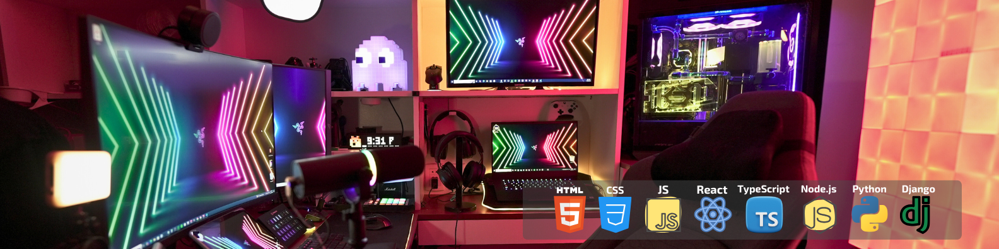

  

# Oh, Hi! ...come on in!

### I'm JP 👋
I wasn't expecting anyone. Thanks for stopping by!

Are you interested in developing full-stack apps that integrate those crazy language models into intuitive user interfaces?

_**Oh wow!**_ **Well, me too!**

  <picture>
    <source media="(prefers-color-scheme: dark)" srcset="./dark.svg" />
    <source media="(prefers-color-scheme: light)" srcset="./light.svg" />
    
  </picture>

 

## 🛠️ Let Me Tell You About What I'm Currently Building (if I may):
> *Most of my recent work has been focused on connecting React with backend LLMs and third-party APIs to create some pretty cool user experiences.*

### 🚀 My Favorite Personal & Open-Source Projects:

- [**KnowNative**](https://github.com/JPEscobari/KnowNative) — **Open-Source Tech Lead** | *React, Node.js, Express, MongoDB, OpenAI API*  
  KN is an open-source reading comprehension web app for language learners. I led a volunteer engineering team to expand the core engine from Traditional Chinese into a language-agnostic platform powered by AI text tokenization and context-aware translations.

- [**Travel Genie**](https://github.com/JPEscobari/Travel-Genie) — **Full-Stack Developer** | *MERN Stack, Google Places, OpenAI, Unsplash*  
  An intelligent itinerary generator that orchestrates location data, AI-driven scheduling, and contextual images tailored to dates, party size, and family travel constraints. Includes a social feature where users can explore what other members of the community have generated.

- [**Deal Hero**](https://github.com/arzansa/deal-hero) — **Full-Stack Engineer** | *Python, Django, Web Scraping*  
  An automated retail price-tracking engine that scrapes product data across e-commerce platforms to monitor price fluctuations and calculate which major retailer offers the most savings for a particular product.

- [**Juke.ly**](https://github.com/JPEscobari/Juke-ly) — **Full-Stack Developer** | *JavaScript, YouTube API*  
  Juke.ly is a single-page Jukebox application designed for parties interested in quickly creating a shared YouTube video queue. The queue and player live on the same page resembling a real Jukebox, so everyone knows if their request is coming up next.

- [**Texas Hold 'Em Video Poker**](https://github.com/JPEscobari/Video-Poker) — **Frontend / Game Logic Engineer** | *JavaScript, HTML5, CSS3*  
  Browser-based Vegas-style Video Poker simulation featuring pure client-side DOM manipulation, hand-evaluation algorithms, and payout mechanics. This is my favorite sandbox for testing pure vanilla JS state logic without a framework!

## Are You Looking for a Programming Hand?
I do really well (*I thrive!*) in async-friendly, community-driven environments. If you’re building civic tech, open-source tools, or any type of high-impact web apps using the MERN stack or Python, hit me up! I'd love to hear your ideas!

## Learning Can't Stop, Won't Stop 🎓 !
At the same time, I'm pursuing my **M.S. in Computer Science (Artificial Intelligence concentration)** at NSU Florida, studying for my **AWS Certified Solutions Architect** certification, and participating in as many hackathons as possible.

## ⚡ Beyond the Code:
- 🌐 **Network Roots:** I have a B.S. in Computer Networks. I've worked as a Network Admin in the insurance sector for 5 years. Fair to say my home network is heavily optimized.
- 🏎️ **Weekend Mechanic:** Hands-on with car audio installations and 12-volt automotive wiring. I've seen my car's guts.
- 🏋️ **Strength & Iron:** I'm also a former strength coach. I love compound lifting, but I take a more relaxed approach now that I've decided to go full geek.
- 🐶 **Office Supervisors:** I'm powered by caffeine, good tunes, and two dachshunds (Pancetta & Wata).

## 💻 Tech Stack:

## 📊 GitHub Stats:

  <!-- 
  
    -->
  

## 🌐 Socials & Connect:

